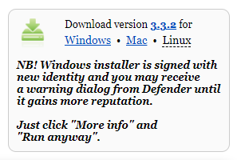
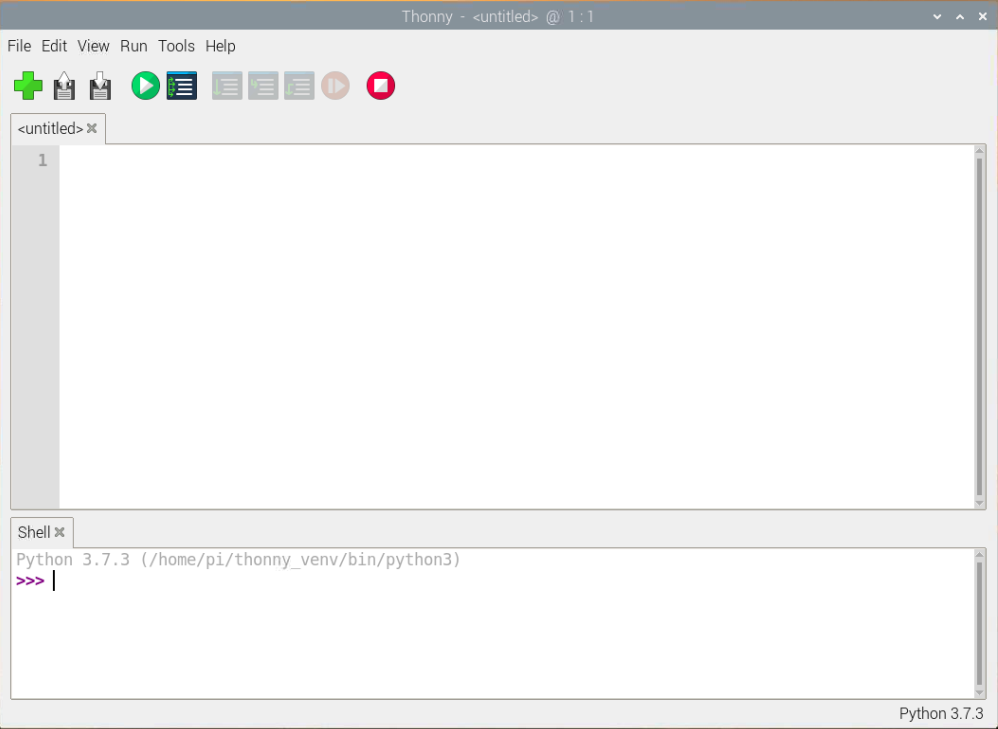

## Instala Thonny en una Raspberry Pi

- Thonny ya está instalado en Raspberry Pi OS, pero puede que necesites actualizarlo a la última versión
- Abre una ventana de terminal haciendo clic en el ícono de la esquina superior izquierda de la pantalla o presionando las teclas Ctrl+Alt+T al mismo tiempo
- En la ventana, escribe lo siguiente para actualizar tu sistema operativo y Thonny

```bash
sudo apt update && sudo apt upgrade -y
```

## Instala Thonny en otros sistemas operativos

- En Windows, macOS y Linux, puedes instalar la última versión del entorno de desarrollo Thonny o actualizar una versión existente
- En un navegador web, ve a [thonny.org](https://thonny.org/){:target="_blank"}
- En la esquina superior derecha de la ventana del navegador, verás enlaces de descarga para Windows y macOS, e instrucciones para Linux
- Descarga los archivos correspondientes y ejecútalos para instalar Thonny



## Abre Thonny

Abre Thonny desde tu lanzador de aplicaciones. Deberías tener algo como esto:



Puedes usar Thonny para escribir código estándar de Python. Escribe lo siguiente en la ventana principal y luego haz clic en el botón **Ejecutar** (se te pedirá que guardes el archivo).

```python3
print('Hello World!')
```


